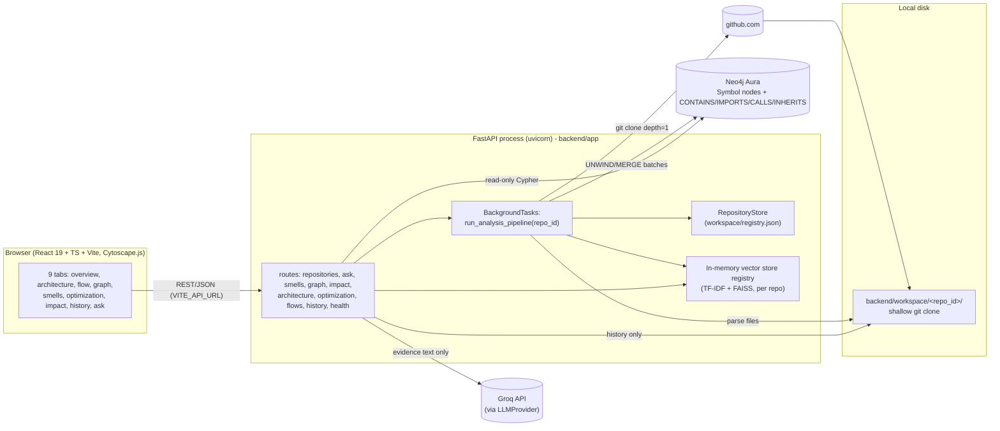
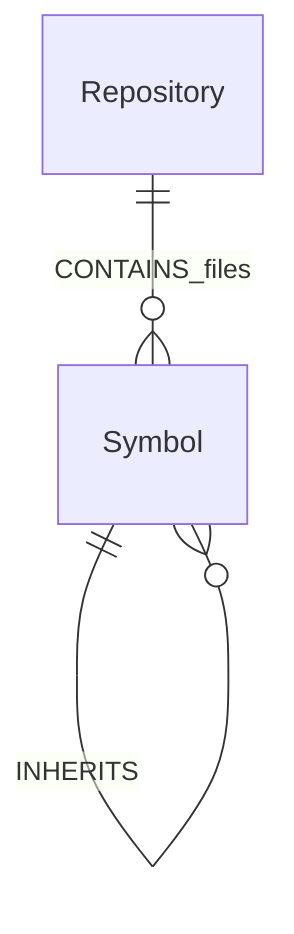
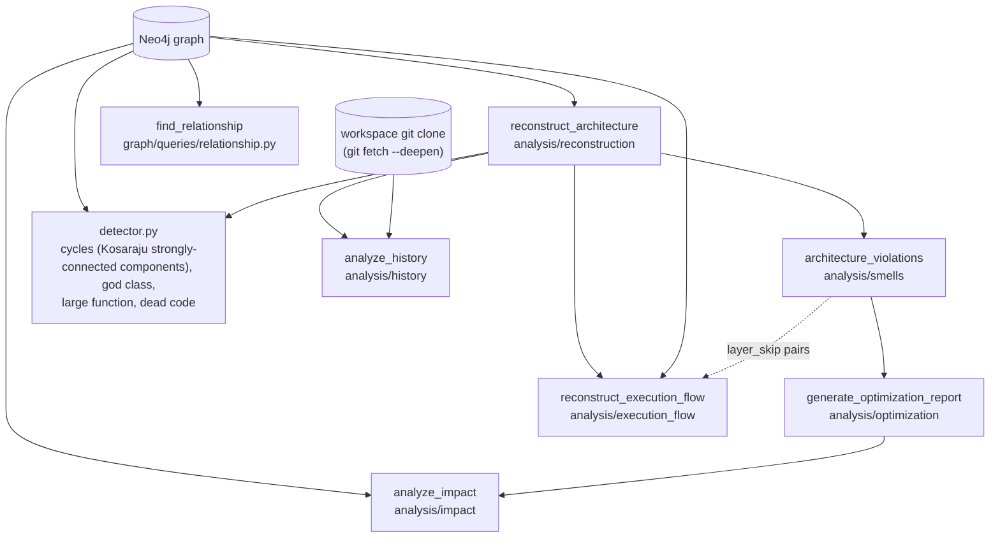
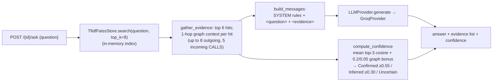

# ARCHITECTURE_AND_DATA_FLOW.md — CodeBase Archeologist (as implemented, 2026-10-11)

This describes the system **as it exists in the working tree**, not the roadmap. Where `CLAUDE.md`/`README.md` describe something different, the difference is flagged under "Discrepancies" (§7).

---

## 1. Runtime components



State that is **not** durable: the vector index (rebuilt only by re-ingestion). State that is durable: Neo4j graph (cloud), `registry.json`, cloned workspaces.

## 2. Ingestion pipeline (`backend/app/services/pipeline.py`)

```mermaid
sequenceDiagram
    participant C as Client
    participant A as POST /api/repositories (202)
    participant S as GitHubRepositoryService
    participant P as graph_pipeline.build_graph_for_repository
    participant L as graph.loader
    participant N as Neo4j
    C->>A: {url}
    A->>S: register(url) → validate_github_url
    S-->>A: record(status=pending)
    A-->>C: 202 + record
    Note over A: BackgroundTasks.add_task(run_analysis_pipeline)
    A->>S: ingest(repo_id): status=cloning
    S->>S: shallow_clone(depth=1), scan_workspace (limits), detect languages
    S-->>A: status=cloned
    A->>P: status=parsing
    P->>P: for each file with implemented parser: parser.parse_file → ParsedFile(IR)
    P->>L: status=building_graph
    L->>L: resolve_relationships(all symbols, all relationships)
    L->>N: ensure_schema; MERGE Repository, Symbol nodes (batch 500), CONTAINS/IMPORTS/CALLS/INHERITS edges
    L->>N: SET unresolved_call_targets on source symbols
    P->>P: status=embedding: TfidfFaissStore.build(files, classes, functions, methods)
    P-->>C: status=ready (client polls GET /api/repositories/{id})
```

Status values in code: `pending → cloning → cloned → parsing → building_graph → embedding → ready`, or `failed` (with `error`). The `reconstructing` state listed in `CLAUDE.md` §8 **does not exist**: architecture reconstruction is computed on demand per request, not during ingestion.

## 3. Parsing and Intermediate Representation

* One `LanguageParser` subclass per language (`parsing/parsers/{python,javascript,typescript,java,cpp}/parser.py`), dispatched by file extension through `PARSER_REGISTRY` (`app/services/graph_pipeline.py`, extension map in `app/core/languages.py`). Tree-sitter grammars are loaded in `parsing/tree_sitter/loader.py`.
* IR (`parsing/ir/models.py`): `Symbol{id, name, qualified_name, symbol_type, file_path, start_line, end_line, language, decorators, docstring}`; `Relationship{source_id, target_id|None, target_name, relationship_type, source_file, source_line, confidence}`; `ParsedFile`.
* Parsers emit `CONTAINS` and `IMPORTS` with confidence 1.0 and `CALLS`/`INHERITS` with `target_id=None` and a raw `target_name` (Python call confidence starts at 0.5).
* **Cross-file resolution** (`parsing/ir/resolver.py`, run once inside `load_repository_graph`):
  1. exact `qualified_name` match → `target_id` set, confidence **0.95**;
  2. else last dotted segment; exactly one symbol with that short name (class/function/method) → confidence **0.75**;
  3. several candidates → left unresolved, confidence **0.3** (ambiguous);
  4. none → left unresolved, confidence ≤ 0.35 (external/dynamic).
  Imports are *not* consulted. Unresolved `CALLS` are not graph edges; their raw names are saved on the caller (`unresolved_call_targets`) and later used only by Execution Flow to label why a trace ended.

## 4. Graph schema (Neo4j)



* Nodes: `(:Symbol:<File|Class|Function|Method|Import|Variable>)` with properties `uid` (= `"{repo_id}:{symbol.id}"`, unique constraint), `id`, `repo_id`, `symbol_type`, `name`, `qualified_name`, `file_path`, `start_line`, `end_line`, `language`, `decorators`, `docstring`, optional `unresolved_call_targets`. One `(:Repository {id, owner, name, url, default_branch, commit_sha})` per ingest.
* Edges: `CONTAINS`, `IMPORTS`, `CALLS`, `INHERITS`; each carries `source_file`, `source_line`, `confidence`. (`MERGE` key includes `source_line`.)
* `USES` appears only in the graph-view API as a *derived* aggregate (file→file and class→class); it is not stored.
* Other node kinds named in `CLAUDE.md` §11 (API, Endpoint, Database, ExternalService, Commit, Author, …) are **not** in the graph; endpoints, databases and external services are inferred at analysis time from decorators/imports, and commits are read from Git at request time.
* Constraints: `repository_id`, `symbol_uid` (`graph/schema/constraints.py`).

## 5. On-demand analysis layer

All engines are read-only over Neo4j and are recomputed on every request (no caching).



| Engine | Inputs | Deterministic method | Output |
|---|---|---|---|
| Architecture Reconstruction | File, Symbol, Import nodes; cross-file CALLS edges | Group files by first 2 directory levels (`group_key`); rank by symbol count, keep 40; first-match rule cascade for role: test-dir → api (route decorator / "api","route" in path) → data_access (`*Repository/*Dao`, DB-package imports, path words) → external_integration (`*Client/*Gateway`, any non-stdlib import, path words) → service (`*Service/*Controller/*Manager/*Handler`) → model → other; confidence = additive evidence score; relationships = aggregated cross-component CALLS (count, mean resolver confidence, 3 example `file:line`) | `ArchitectureModel` |
| Architecture Analysis | graph + `ArchitectureModel` | Per-symbol: Kosaraju SCC search on CALLS; god class (methods ≥15/25/40); large function (lines ≥60/100/150); dead-code candidates (no caller, no decorator; max 20). Per-component: boundary violation (layer order api<service<data/external), layer skip (api→data/external when a service component exists), mutual component dependency, coupling (degree ≥6 MEDIUM, ≥10 HIGH). Finding confidence = documented blend of base value, resolver confidence and context discounts (`SUPPORTING_STRUCTURE`, `FRAMEWORK_HUB`, `EXPECTED_TEST_DEPENDENCY`, …) | `Smell` list with `evidence_details`, `context_flags`, stable content-addressed `id` |
| Optimization | violation records | One templated proposal per component-level violation; risk = `analyze_impact` on the most-connected symbol of the affected components (falls back to violation severity) | `OptimizationReport` |
| Execution Flow | graph CALLS adjacency, `ArchitectureModel`, imports, `unresolved_call_targets` | DFS from a route-decorated entry; max depth 5, 3 highest-confidence callees per hop, 150 hops total, cycle-safe; `terminal_kind` = role badge (database / external_service) only; `terminal_reason` ∈ {NO_RESOLVED_CALLEES, STANDARD_LIBRARY, EXTERNAL_DEPENDENCY, UNRESOLVED, DEPTH_LIMIT, BRANCH_LIMIT}; PROPOSED variant splices a synthetic service hop at each `layer_skip` pair | `ExecutionFlowReport` (OBSERVED + optional PROPOSED) |
| Impact & Risk | graph | Reverse BFS over CALLS\|INHERITS to depth 8; classifiers for API/service/test/external; point rubric (dependents 0–4, API +2, service +1, no tests +2, external +1, degree ≥15 +1) → LOW <3, MEDIUM 3–4, HIGH 5–7, CRITICAL ≥8 | `ImpactReport` with named `RiskSignal`s |
| Relationship | graph | Direct edge (CALLS\|IMPORTS\|INHERITS\|CONTAINS, either direction) else `shortestPath` over CALLS\|INHERITS\|CONTAINS ≤ 6 hops; else "not connected" | `RelationshipResult` |
| History | Git log of the workspace clone + `ArchitectureModel` | Map each commit's changed files to current components; count, first/last date, top-3 authors, oldest commit as "introduction" | `HistoryReport` |

## 6. Retrieval and LLM explanation



* The LLM sees symbol names, file/line locations and relationship lines — **not** source code bodies. Docstrings/decorators are used only to build the TF-IDF vectors, not in the prompt.
* Relationship explanation: graph path first (`find_relationship`); if not connected the fixed sentence is returned and **no LLM call is made**; otherwise the path is rendered as text and Groq narrates it (2–4 sentences, per prompt).
* Provider isolation: only `ai/llm/groq_provider.py` imports the Groq SDK; `ai/llm/factory.py` selects it. Model name and key come from environment variables (`GROQ_API_KEY`, `GROQ_MODEL`).
* Architecture, analysis, optimization, flow and impact responses contain **no LLM output** (the optimization/flow/analysis engines make no LLM calls). Only `/ask` and `/graph/relationship` do.

## 7. Discrepancies between documentation and implementation

| Documentation says | Implementation |
|---|---|
| `CLAUDE.md` §8 lists a `reconstructing` pipeline state | Not present in `RepositoryStatus`; reconstruction is on-demand. Code has an extra `cloned` state. |
| `CLAUDE.md` §11 lists `USES` as a core stored relationship and many node kinds (API, Database, Commit, …) | Stored edges are only CONTAINS/IMPORTS/CALLS/INHERITS; `USES` is derived in views; no API/Database/Commit nodes. |
| README: "TF-IDF/vector retrieval", "semantic" | TF-IDF is lexical; no neural embeddings. |
| README/`CLAUDE.md`: "Hybrid graph + vector evidence retrieval" | Vector search first, then 1-hop graph expansion per hit; no independent graph-retrieval path. |
| `CLAUDE.md` §33 `test_repositories/` golden fixtures | Directory does not exist. |
| `CLAUDE.md` §27/§28 Historical Reconstruction (architecture snapshots, renames, "why") | Only per-component commit statistics. |
| README: "Execution Flow … down to the database/external service … stops at data_access / external_integration" | Outdated in the working tree: traversal no longer stops at those roles (see `engine.py` docstring). README text was not updated. |
| README Architecture box mentions `docs/ROADMAP.md` | `ROADMAP.md` predates the rebrand (it still says "CodeSage", Grok, Health Scoring); README itself says to treat `CLAUDE.md` as current. |
| `CLAUDE.md` lists `docs/architecture/`, `docs/adr/` | Do not exist. |
| `backend/app/main.py` titles the API "CodeSage API" | Project name used in code is CodeSage; documents use CodeBase Archeologist. |
| `ROADMAP.md`: FAISS + relational DB (jobs/users) | FAISS (TF-IDF) is used; there is no relational DB — a JSON file stores repository records. |
